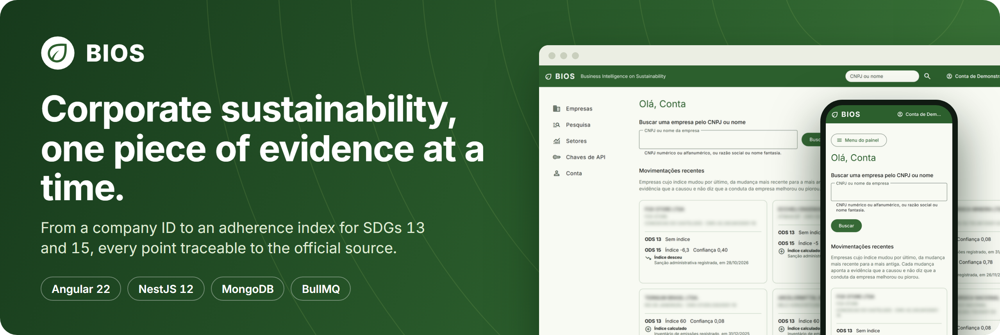
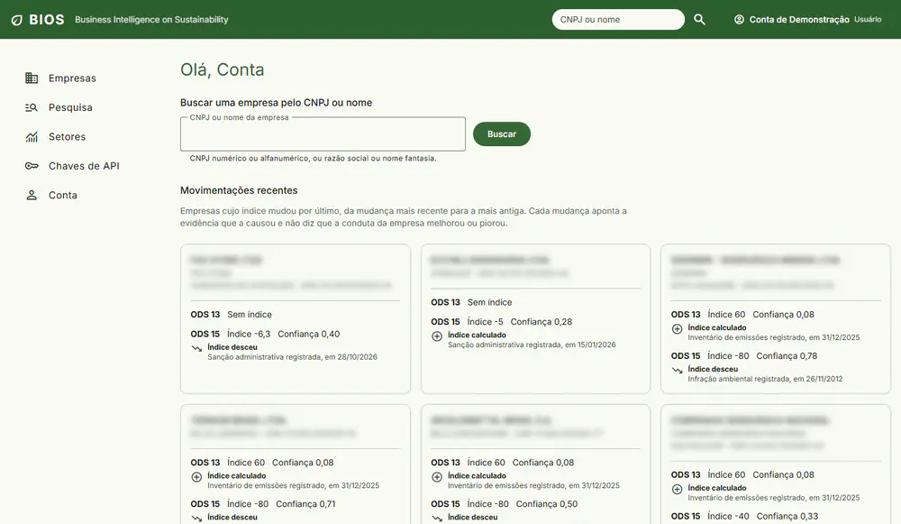
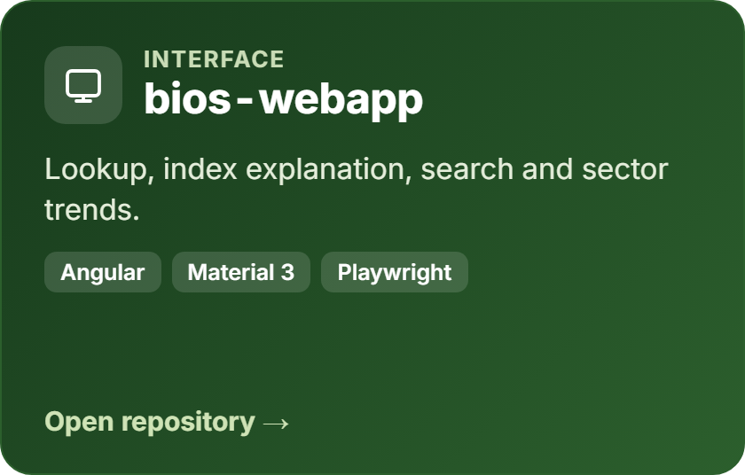
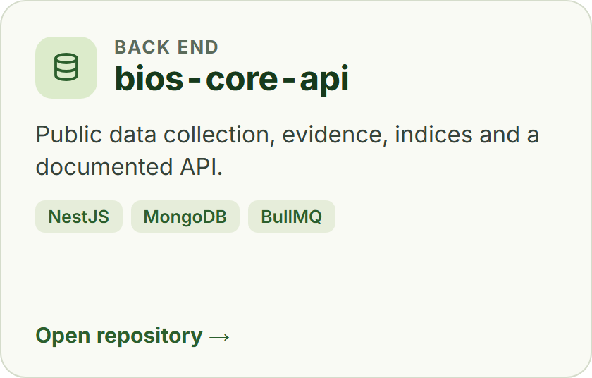
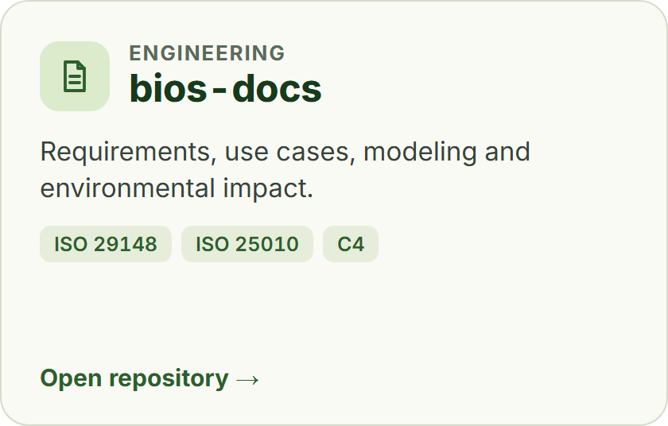
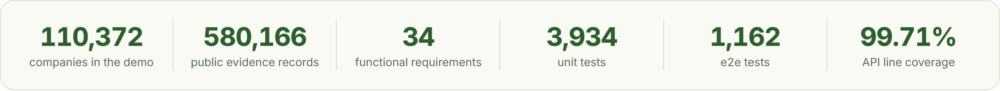
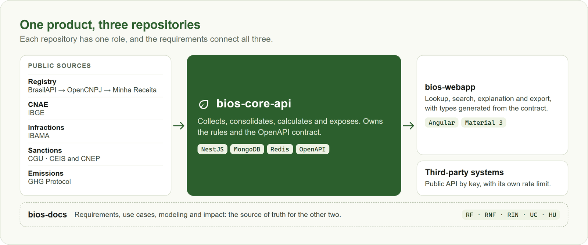

  

  🇧🇷 <a href="README.md">Português</a> · 🇺🇸 <strong>English</strong>

  

# BIOS — Business Intelligence on Sustainability

BIOS uses the CNPJ, the Brazilian company registry number, as the axis to gather public environmental
evidence about Brazilian companies and to explain, evidence by evidence, how each one adheres to SDGs
13 (climate action) and 15 (life on land). The index always comes with a confidence level and a path
back to the official source.

> **Evidence First:** no index exists without traceable evidence, and missing data lowers the
> confidence, never the index.

## See it working

<table>
  <tr>
    <td width="66%" valign="middle"></td>
    <td width="34%" valign="middle" align="center"></td>
  </tr>
</table>

The demo opens right away, with no sign-up, and runs in the browser on static files generated from
real public data. The account is fictional, and nothing you do there leaves your tab. The interface
is in Portuguese.

## The three repositories

  
  
  

  

## How the parts connect

  

## Where to start

| If you want to see                            | Go to                                                          |
| :-------------------------------------------- | :------------------------------------------------------------- |
| The product in use                            | [Demo](https://bios-webapp.vercel.app/demonstracao)            |
| Interface, accessibility and end-to-end tests | [bios-webapp](https://github.com/odavibatista/bios-webapp)     |
| Data collection, index rules and API contract | [bios-core-api](https://github.com/odavibatista/bios-core-api) |
| Requirements, traceability and method         | [bios-docs](https://github.com/odavibatista/bios-docs)         |

## Privacy and data removal

BIOS works with public data linked to the CNPJ. A sole proprietor's registered name and address may
contain the owner's personal data, even though they are public at the Federal Revenue Service. A CPF
in the registered name is masked, and partners and contacts are not collected.

To request the removal of a record, write to **odavibatista@hotmail.com** with the CNPJ and proof that
you are the owner. The details are on the
[privacy page](https://bios-webapp.vercel.app/privacidade).

## Author

A project by **Davi Deosmar Batista Oliveira Miranda**, from São Paulo, for the Computer Science
program at Universidade São Judas Tadeu (USJT), in the Software Engineering and Software Management
and Quality courses.

  
  

## License

All rights reserved. The repositories are public for reference and academic assessment; see
[LICENSE](LICENSE).
