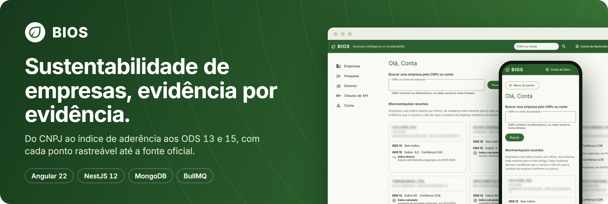
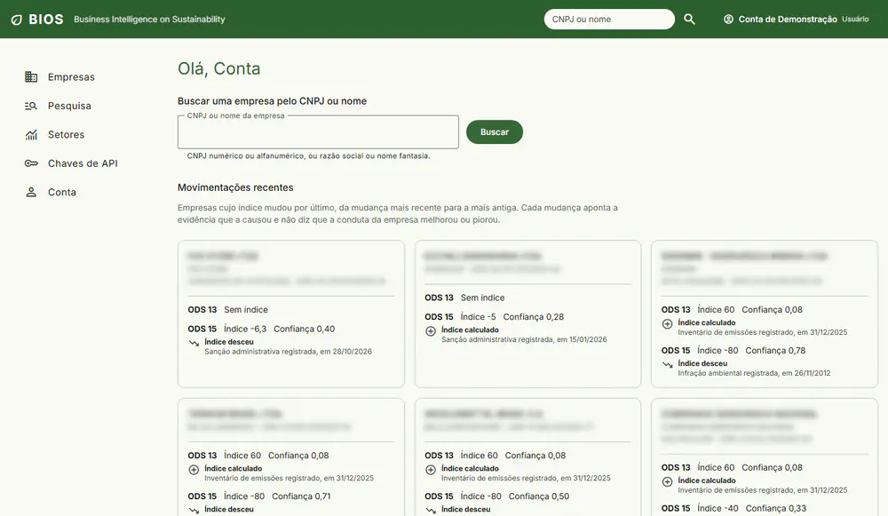
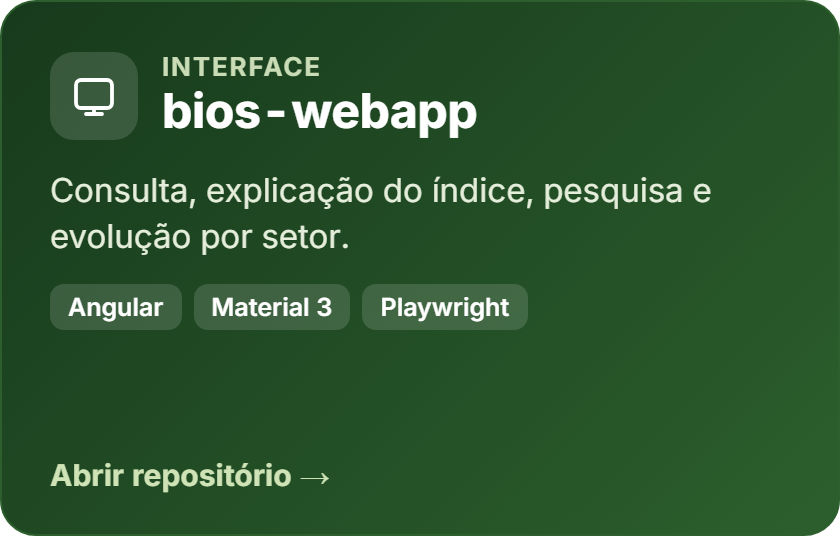
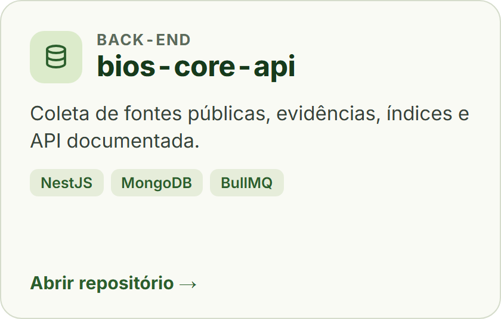
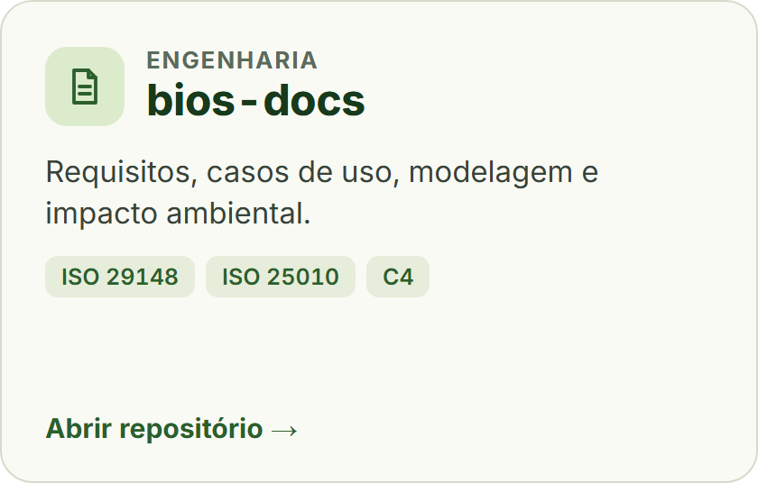
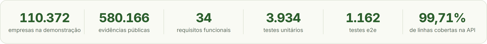
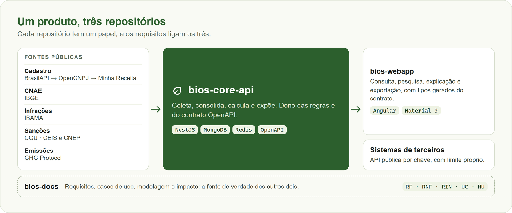

  

  🇧🇷 <strong>Português</strong> · 🇺🇸 <a href="README.en.md">English</a>

  

# BIOS — Business Intelligence on Sustainability

O BIOS usa o CNPJ como eixo para reunir evidências ambientais públicas de empresas brasileiras e
explicar, evidência por evidência, a aderência de cada uma aos ODS 13 (ação climática) e 15 (vida
terrestre). O índice vem sempre com um nível de confiança e com o caminho até a fonte oficial.

> **Evidence First:** nenhum índice existe sem evidência rastreável, e a ausência de dado reduz a
> confiança, nunca o índice.

## Veja funcionando

<table>
  <tr>
    <td width="66%" valign="middle"></td>
    <td width="34%" valign="middle" align="center"></td>
  </tr>
</table>

A demonstração abre direto, sem cadastro, e roda no navegador sobre arquivos estáticos gerados com
dados públicos reais. A conta é fictícia e nada do que você fizer ali sai da sua aba.

## Os três repositórios

  
  
  

  

## Como as partes se ligam

  

## Por onde começar

| Se você quer ver                                    | Vá para                                                        |
| :-------------------------------------------------- | :------------------------------------------------------------- |
| O produto em uso                                    | [Demonstração](https://bios-webapp.vercel.app/demonstracao)    |
| Interface, acessibilidade e testes de ponta a ponta | [bios-webapp](https://github.com/odavibatista/bios-webapp)     |
| Coleta de dados, regras do índice e contrato da API | [bios-core-api](https://github.com/odavibatista/bios-core-api) |
| Requisitos, rastreabilidade e método                | [bios-docs](https://github.com/odavibatista/bios-docs)         |

## Privacidade e remoção de dados

O BIOS trabalha com dados públicos ligados ao CNPJ. A razão social e o endereço de um empresário
individual podem conter dados pessoais do titular, mesmo sendo públicos na Receita Federal. O CPF na
razão social é mascarado, e sócios e contatos não são coletados.

Para pedir a remoção de um cadastro, escreva para **odavibatista@hotmail.com** com o CNPJ e uma
comprovação de que você é o titular. Os detalhes estão na
[página de privacidade](https://bios-webapp.vercel.app/privacidade).

## Autor

Projeto de **Davi Deosmar Batista Oliveira Miranda**, de São Paulo, no curso de Ciência da Computação
da Universidade São Judas Tadeu (USJT), para as disciplinas de Engenharia de Software e de Gestão e
Qualidade de Software.

  
  

## Licença

Todos os direitos reservados. Os repositórios são públicos para consulta e avaliação acadêmica; veja
[LICENSE](LICENSE).
